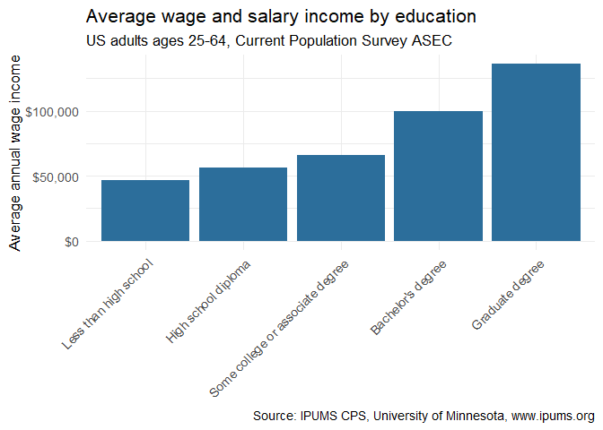

Earnings by Education in the United States
================
Nivin Varghese
2026-10-30

<!-- Knitting with github_document produces a .md file and a figure folder -->

<!-- that GitHub renders directly in your repository. That rendered file is -->

<!-- your published document. Commit and push the .md and the _files folder. -->

<!-- Step-by-step upload instructions are in Part 3 of the activity file. -->

<!-- Do NOT upload the data/ folder to GitHub. -->

## Load your IPUMS extract

Point `read_ipums_micro()` at the DDI codebook (.xml), not the data
file. Both files live in the `data/` folder and share the same base
name. Change the file name below to match your extract number.

``` r
ddi <- read_ipums_ddi("data/cps_00001.xml")
cps <- read_ipums_micro(ddi)   # changed file name

# Peek at what you have
ipums_var_info(cps)
```

    ## # A tibble: 14 × 4
    ##    var_name var_label                                        var_desc val_labels
    ##    <chr>    <chr>                                            <chr>    <list>    
    ##  1 YEAR     Survey year                                      "YEAR r… <tibble>  
    ##  2 SERIAL   Household serial number                          "SERIAL… <tibble>  
    ##  3 MONTH    Month                                            "MONTH … <tibble>  
    ##  4 CPSID    CPSID, household record                          "CPSID … <tibble>  
    ##  5 ASECFLAG Flag for ASEC                                    "ASECFL… <tibble>  
    ##  6 ASECWTH  Annual Social and Economic Supplement Household… "ASECWT… <tibble>  
    ##  7 PERNUM   Person number in sample unit                     "PERNUM… <tibble>  
    ##  8 CPSIDP   CPSID, person record                             "CPSIDP… <tibble>  
    ##  9 CPSIDV   Validated Longitudinal Identifier                "CPSIDV… <tibble>  
    ## 10 ASECWT   Annual Social and Economic Supplement Weight     "ASECWT… <tibble>  
    ## 11 AGE      Age                                              "Age gi… <tibble>  
    ## 12 SEX      Sex                                              "SEX gi… <tibble>  
    ## 13 EDUC     Educational attainment recode                    "EDUC i… <tibble>  
    ## 14 INCWAGE  Wage and salary income                           "INCWAG… <tibble>

``` r
head(cps)
```

    ## # A tibble: 6 × 14
    ##    YEAR SERIAL MONTH       CPSID ASECFLAG  ASECWTH PERNUM  CPSIDP  CPSIDV ASECWT
    ##   <dbl>  <dbl> <int+lbl>   <dbl> <int+lbl>   <dbl>  <dbl>   <dbl>   <dbl>  <dbl>
    ## 1  2026      1 3 [March] 2.03e13 1 [ASEC]    1149.      1 2.03e13 2.03e14  1149.
    ## 2  2026      1 3 [March] 2.03e13 1 [ASEC]    1149.      2 2.03e13 2.03e14  1149.
    ## 3  2026      5 3 [March] 2.03e13 1 [ASEC]     882.      1 2.03e13 2.03e14   882.
    ## 4  2026      6 3 [March] 2.02e13 1 [ASEC]    1098.      1 2.02e13 2.02e14  1098.
    ## 5  2026     12 3 [March] 2.03e13 1 [ASEC]    1100.      1 2.03e13 2.03e14  1100.
    ## 6  2026     13 3 [March] 2.02e13 1 [ASEC]    1063.      1 2.02e13 2.02e14  1063.
    ## # ℹ 4 more variables: AGE <int+lbl>, SEX <int+lbl>, EDUC <int+lbl>,
    ## #   INCWAGE <dbl+lbl>

``` r
ipums_val_labels(cps$EDUC)
```

    ## # A tibble: 36 × 2
    ##      val lbl                 
    ##    <int> <chr>               
    ##  1     0 NIU or no schooling 
    ##  2     1 NIU or blank        
    ##  3     2 None or preschool   
    ##  4    10 Grades 1, 2, 3, or 4
    ##  5    11 Grade 1             
    ##  6    12 Grade 2             
    ##  7    13 Grade 3             
    ##  8    14 Grade 4             
    ##  9    20 Grades 5 or 6       
    ## 10    21 Grade 5             
    ## # ℹ 26 more rows

``` r
print(ipums_val_labels(cps$EDUC), n = 36)
```

    ## # A tibble: 36 × 2
    ##      val lbl                                                
    ##    <int> <chr>                                              
    ##  1     0 NIU or no schooling                                
    ##  2     1 NIU or blank                                       
    ##  3     2 None or preschool                                  
    ##  4    10 Grades 1, 2, 3, or 4                               
    ##  5    11 Grade 1                                            
    ##  6    12 Grade 2                                            
    ##  7    13 Grade 3                                            
    ##  8    14 Grade 4                                            
    ##  9    20 Grades 5 or 6                                      
    ## 10    21 Grade 5                                            
    ## 11    22 Grade 6                                            
    ## 12    30 Grades 7 or 8                                      
    ## 13    31 Grade 7                                            
    ## 14    32 Grade 8                                            
    ## 15    40 Grade 9                                            
    ## 16    50 Grade 10                                           
    ## 17    60 Grade 11                                           
    ## 18    70 Grade 12                                           
    ## 19    71 12th grade, no diploma                             
    ## 20    72 12th grade, diploma unclear                        
    ## 21    73 High school diploma or equivalent                  
    ## 22    80 1 year of college                                  
    ## 23    81 Some college but no degree                         
    ## 24    90 2 years of college                                 
    ## 25    91 Associate's degree, occupational/vocational program
    ## 26    92 Associate's degree, academic program               
    ## 27   100 3 years of college                                 
    ## 28   110 4 years of college                                 
    ## 29   111 Bachelor's degree                                  
    ## 30   120 5+ years of college                                
    ## 31   121 5 years of college                                 
    ## 32   122 6+ years of college                                
    ## 33   123 Master's degree                                    
    ## 34   124 Professional school degree                         
    ## 35   125 Doctorate degree                                   
    ## 36   999 Missing/Unknown

## Clean and prepare

Filter to working-age adults (25-64) with valid wage income. IPUMS uses
large numeric codes for missing or not-in-universe values, so we drop
INCWAGE values of 99999998 and above.

``` r
cps_clean <- cps %>%
  filter(
    AGE >= 25 & AGE <= 64,
    INCWAGE > 0 & INCWAGE < 99999998
  ) %>%
  mutate(
    educ_group = case_when(
      EDUC < 6   ~ "Less than high school",
      EDUC == 6  ~ "High school diploma",
      EDUC < 10   ~ "Some college or associate degree",
      EDUC == 10 ~ "Bachelor's degree",
      EDUC == 11 ~ "Graduate degree"
    ),
    educ_group = factor(educ_group, levels = c(
      "Less than high school", "High school diploma",
      "Some college or associate degree", "Bachelor's degree",
      "Graduate degree"
    ))
  )
```

\#missing values handled

``` r
cps_clean <- cps %>%
  mutate(educ = as.numeric(EDUC)) %>%
  filter(
    AGE >= 25 & AGE <= 64,
    INCWAGE > 0 & INCWAGE < 99999998,
    educ >= 2 & educ < 999          # drop NIU (0, 1) and missing (999)
  ) %>%
  mutate(
    educ_group = case_when(
      educ <= 71               ~ "Less than high school",
      educ %in% c(72, 73)      ~ "High school diploma",
      educ >= 80 & educ <= 100 ~ "Some college or associate degree",
      educ %in% c(110, 111)    ~ "Bachelor's degree",
      educ >= 120              ~ "Graduate degree"
    ),
    educ_group = factor(educ_group, levels = c(
      "Less than high school", "High school diploma",
      "Some college or associate degree", "Bachelor's degree",
      "Graduate degree"
    ))
  ) %>%
  filter(!is.na(educ_group))

# Sanity check: every group should have a reasonable count, and no NA row
count(cps_clean, educ_group)
```

    ## # A tibble: 5 × 2
    ##   educ_group                           n
    ##   <fct>                            <int>
    ## 1 Less than high school             2778
    ## 2 High school diploma              12681
    ## 3 Some college or associate degree 12488
    ## 4 Bachelor's degree                14065
    ## 5 Graduate degree                   9325

## Visualize

Average wage and salary income (INCWAGE) by education group.

``` r
cps_clean %>%
  group_by(educ_group) %>%
  summarize(avg_wage = mean(INCWAGE)) %>% 
  ggplot(aes(x = educ_group, y = avg_wage)) +
  geom_col(fill = "#2C6E9B") +
  scale_y_continuous(labels = dollar_format()) +
  labs(
    title = "Average wage and salary income by education",
    subtitle = "US adults ages 25-64, Current Population Survey ASEC",
    x = NULL,
    y = "Average annual wage income",
    caption = "Source: IPUMS CPS, University of Minnesota, www.ipums.org"
  ) +
  theme_minimal(base_size = 13) +
  theme(
    axis.text.x = element_text(
      angle = 45,
      hjust = 1
    )
  )
```


\#meaningful categories

``` r
cps_clean %>%
  group_by(educ_group) %>%
  summarize(avg_wage = weighted.mean(INCWAGE, ASECWT)) %>%
  ggplot(aes(x = educ_group, y = avg_wage)) +
  geom_col(fill = "#2C6E9B") +
  geom_text(aes(label = dollar(avg_wage, accuracy = 1)),
            vjust = -0.4, size = 3.8) +
  scale_x_discrete(labels = label_wrap(15)) +
  scale_y_continuous(labels = dollar_format(),
                     expand = expansion(mult = c(0, 0.08))) +
  labs(
    title = "Average wage and salary income rises with education",
    subtitle = "Wage earners ages 25-64, 2025 earnings (CPS ASEC 2026)\nWeighted by ASEC person weight (ASECWT)",
    x = NULL,
    y = "Average annual wage income",
    caption = "Source: IPUMS CPS, University of Minnesota, www.ipums.org"
  ) +
  theme_minimal(base_size = 13)
```


## Your interpretation

<!-- What does the chart show? -->

Ans: Among wage earners ages 25–64, average annual wage income rises at
every education level, from about \$46,000 for those without a high
school diploma to about \$135,000 for those with a graduate degree,
nearly three times as much. The biggest single jump is between some
college (\$66,000) and a bachelor’s degree (\$99,000), a gain of about
\$33,000.
<!-- What is one reason this association might differ from the causal -->
<!-- effect of education on earnings? --> Ans: This gap is not the
causal effect of education because of omitted variable bias (ability
bias), people who earn more degrees also tend to have higher ability,
motivation, or family resources, which raise earnings on their own.
Because those traits are not in the data, the chart attributes their
effect to education, so it likely overstates what an extra degree would
add for any given person; estimating the causal effect would require a
method such as an instrumental variable or a natural experiment.

Data note: the starter code used IPUMS USA education codes; I recoded
EDUC to the CPS coding scheme, dropped not-in-universe and missing
values, and weighted averages with ASECWT.

## Stretch goals (optional)

1.  Weight the estimates with the ASEC survey weight:
    `summarize(avg_wage = weighted.mean(INCWAGE, PERWT))`
2.  Fill or facet by SEX. (SEX is a labelled variable; try
    `as_factor(SEX)`.)

``` r
cps_clean %>%
  mutate(sex = as_factor(SEX)) %>%
  group_by(educ_group, sex) %>%
  summarize(avg_wage = weighted.mean(INCWAGE, ASECWT), .groups = "drop") %>%
  ggplot(aes(x = educ_group, y = avg_wage, fill = sex)) +
  geom_col(position = "dodge") +
  scale_x_discrete(labels = label_wrap(15)) +
  scale_y_continuous(labels = dollar_format()) +
  labs(
    title = "Average wage income by education and sex",
    subtitle = "Wage earners ages 25-64, 2025 earnings (CPS ASEC 2026), weighted",
    x = NULL, y = "Average annual wage income", fill = NULL,
    caption = "Source: IPUMS CPS, University of Minnesota, www.ipums.org"
  ) +
  theme_minimal(base_size = 13) +
  theme(legend.position = "top")
```


3.  Try a different chart: a boxplot of INCWAGE by educ_group, or a
    scatterplot of INCWAGE by AGE with a smooth line.

## Citation (required)

Sarah Flood, Miriam King, Renae Rodgers, Steven Ruggles, J. Robert
Warren, Daniel Backman, Etienne Breton, Grace Cooper, Julia A. Rivera
Drew, Stephanie Richards, David Van Riper, and Kari C.W. Williams. IPUMS
CPS: Version 13.0 \[dataset\]. Minneapolis, MN: IPUMS, 2025.
<https://doi.org/10.18128/D030.V13.0> <!--
Sarah Flood, Miriam King, Renae Rodgers, Steven Ruggles, J. Robert Warren, Daniel Backman, Etienne Breton, Grace Cooper, Julia A. Rivera Drew, Stephanie Richards, David Van Riper, and Kari C.W. Williams. IPUMS CPS: Version 13.0 [dataset]. Minneapolis, MN: IPUMS, 2025.
https://doi.org/10.18128/D030.V13.0

-->
